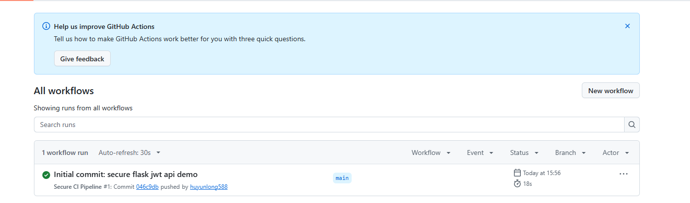
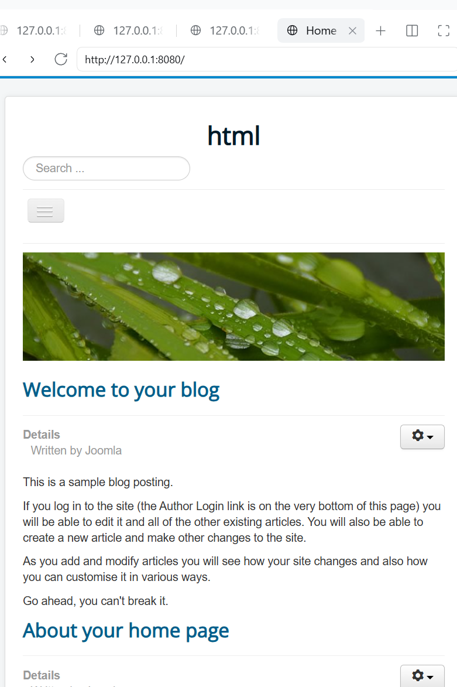
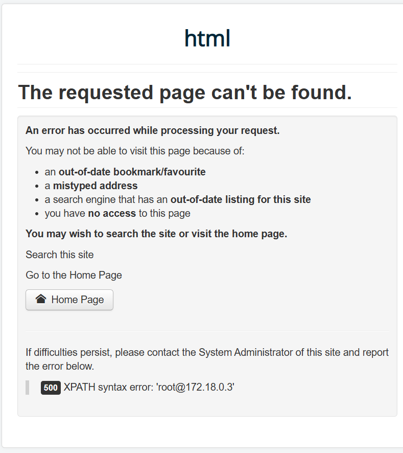
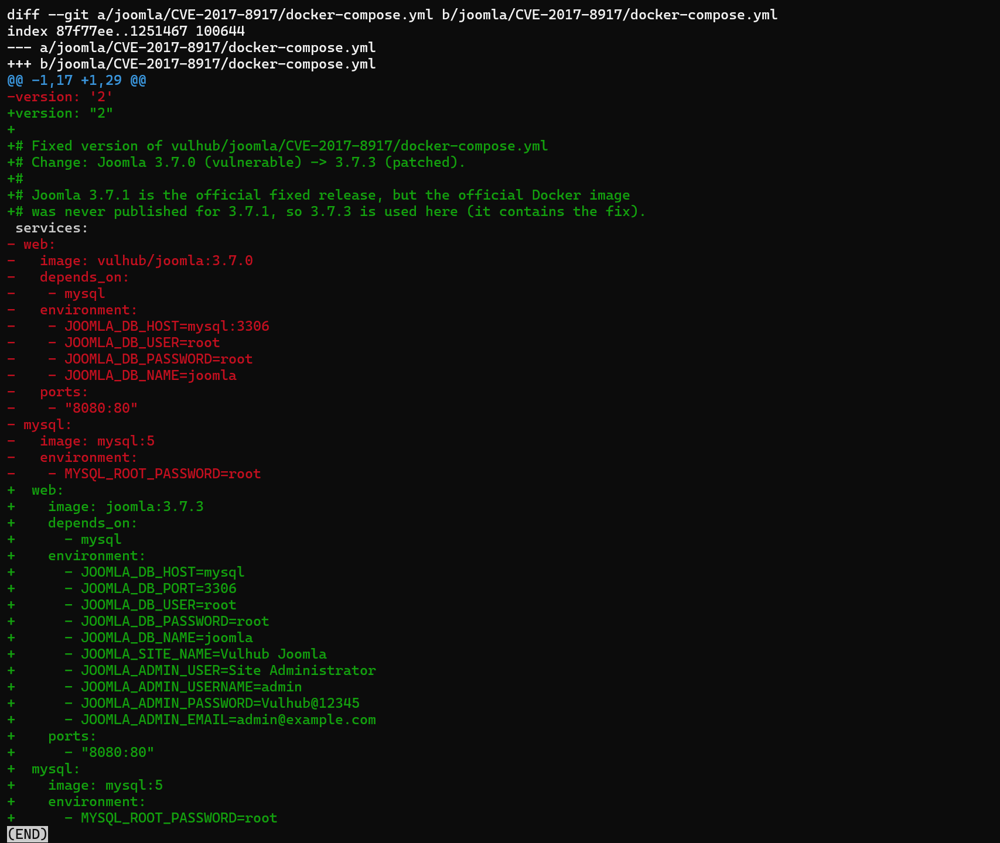
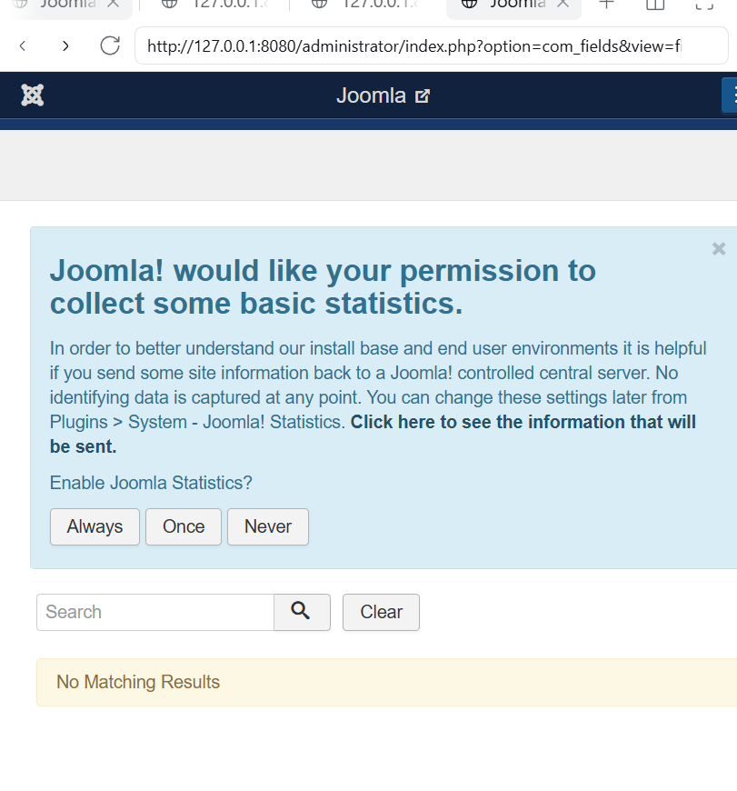
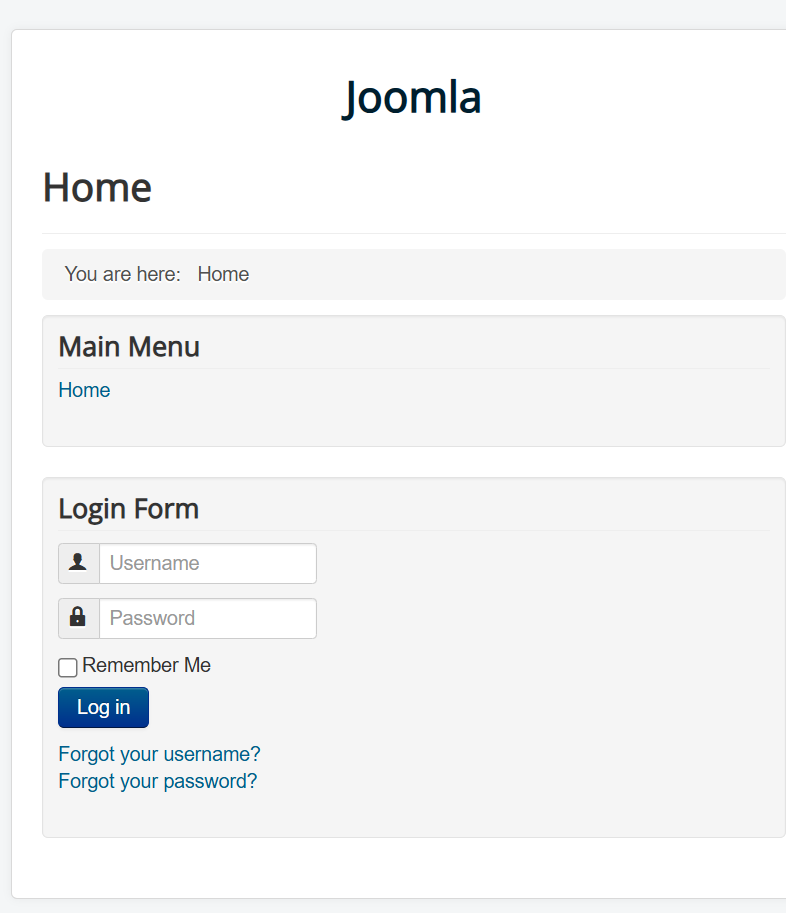

# Secure REST API Development with CI/CD and CVE Vulnerability Analysis

Lab Work 1 | HDU Computer Science

## 1. Project Overview

A secure REST API built with Python and Flask. The API implements JWT authentication,
bcrypt password hashing, ORM-based SQL injection protection and output sanitisation for
XSS. A GitHub Actions pipeline runs static analysis (Bandit) and dependency scanning
(Safety) on every push and pull request.

The second half of the work reproduces, analyses and fixes **CVE-2017-8917**, an
unauthenticated SQL injection in the Joomla! 3.7.0 `com_fields` component, using the
Vulhub environment.

- Repository: https://github.com/huyunlong588/secure-flask-api
- CI runs: https://github.com/huyunlong588/secure-flask-api/actions

## 2. API Endpoints

| Method | Path | Auth | Description |
|---|---|---|---|
| POST | `/auth/login` | No | Verify credentials, return a JWT access token |
| GET | `/api/data` | Bearer JWT | Return the list of registered users |
| POST | `/api/post` | Bearer JWT | Accept and sanitise user content (custom endpoint) |

Demo account: `testuser` / `TestPass123!`

### 2.1 POST /auth/login

```bash
curl -X POST http://127.0.0.1:5000/auth/login \
  -H "Content-Type: application/json" \
  -d '{"username":"testuser","password":"TestPass123!"}'
```

Response `200`:

```json
{"access_token": "eyJhbGciOiJIUzI1NiIsInR5cCI6IkpXVCJ9..."}
```

Invalid credentials return `401 {"msg": "Bad username or password"}`; a missing field
returns `400`.

### 2.2 GET /api/data

```bash
curl http://127.0.0.1:5000/api/data \
  -H "Authorization: Bearer <access_token>"
```

Response `200`:

```json
{"users": [{"id": 1, "username": "testuser"}]}
```

Without a token, with an expired token or with an invalid signature the endpoint returns
`401`.

### 2.3 POST /api/post

```bash
curl -X POST http://127.0.0.1:5000/api/post \
  -H "Content-Type: application/json" \
  -H "Authorization: Bearer <access_token>" \
  -d '{"content":"hello <script>alert(1)</script>"}'
```

Response `201`:

```json
{"msg": "Post saved", "author": "testuser", "content": "hello &lt;script&gt;alert(1)&lt;/script&gt;"}
```

### 2.4 Local run

```bash
python -m venv venv
# Windows: venv\Scripts\activate    Linux/macOS: source venv/bin/activate
pip install -r requirements.txt
python app.py
```

The service listens on `http://127.0.0.1:5000` and creates `instance/app.db` on first run.

## 3. Implemented Security Measures

### 3.1 SQL Injection Protection

All database access goes through SQLAlchemy ORM. Queries are built with the ORM API, for
example:

```python
user = User.query.filter_by(username=data["username"]).first()
```

SQLAlchemy compiles this into a parameterised statement (`WHERE username = ?`), so user
input never becomes part of the SQL text. No raw SQL, string formatting or concatenation
is used anywhere in the project.

### 3.2 XSS Protection

All user-controlled values are sanitised with `bleach.clean()` before they are returned:

```python
safe_name = bleach.clean(u.username)
clean_content = bleach.clean(req_data["content"])
```

The API always answers with `application/json`, so the browser never renders the payload
as HTML. Sanitisation is therefore defence in depth: even if the data is later embedded in
an HTML page, `<script>` tags are neutralised.

### 3.3 Authentication and Password Storage

- Passwords are hashed with **bcrypt** (`bcrypt.gensalt()` + `bcrypt.hashpw()`); each hash
  has its own random salt and the database stores no plaintext password.
- On login, `flask-jwt-extended` issues a JWT signed with **HS256**:
  `create_access_token(identity=user.username)`.
- `@jwt_required()` protects `/api/data` and `/api/post`; it verifies the signature and the
  expiry time, and rejects missing or tampered tokens with `401`.
- The signing key is read from the `JWT_SECRET_KEY` environment variable, with a
  development fallback, so no production secret is hard-coded in the source tree.

## 4. CI/CD Security Pipeline

Workflow file: `.github/workflows/ci.yml`. It runs on every push and pull request to
`main`, and can also be started manually.

| Step | Tool | Purpose |
|---|---|---|
| Smoke test | Python | Import the application to catch syntax/import errors |
| SAST | Bandit | Static analysis of `app.py`, report medium and high severity issues |
| SCA | Safety | Check `requirements.txt` against known vulnerable packages |
| Artifacts | actions/upload-artifact | Keep `bandit-report.txt` and `safety-report.txt` for 30 days |

A failing scan fails the job, so a green check means both scanners completed without
findings.

### 4.1 Pipeline



### 4.2 SAST — Bandit

```text
Run started:2026-10-20 04:14:41

Test results:
        No issues identified.

Code scanned:
        Total lines of code: 62
        Total lines skipped (#nosec): 0

Run metrics:
        Total issues (by severity):
                Undefined: 0
                Low: 0
                Medium: 0
                High: 0
```

Bandit analyses the source without executing it. The project contains no `eval`, no
`subprocess`, no `pickle` and no string-built SQL, and the JWT key is no longer a
hard-coded literal, so the report is clean at every severity level.

### 4.3 SCA — Safety

Safety resolves `requirements.txt` and compares every package version with the
vulnerability database. Runtime dependencies are pinned to patched releases, so no known
vulnerable package remains. The full report is uploaded on every run as the
`safety-report.txt` artifact of the workflow (Actions → run → Artifacts →
`security-reports`).

## 5. CVE-2017-8917: Joomla! 3.7.0 `com_fields` SQL Injection

### 5.1 Basic information

| Item | Value |
|---|---|
| CVE | CVE-2017-8917 |
| Type | SQL Injection (CWE-89), error-based |
| Component | Joomla! CMS 3.7.0, `com_fields` |
| Severity | High — unauthenticated attacker can read the database |
| Fixed in | Joomla! 3.7.1 |
| Advisory | https://developer.joomla.org/security-centre/692-20170501-core-sql-injection.html |

`com_fields` was introduced in 3.7.0. Its list view accepts a `list[fullordering]`
parameter that is used to build the `ORDER BY` clause of the SQL query.

### 5.2 Environment

```bash
git clone https://github.com/vulhub/vulhub.git
cd vulhub/joomla/CVE-2017-8917
docker compose up -d
```

Service: `http://127.0.0.1:8080`

> If the bundled installer fails with `Unknown MySQL server host 'mysql:3306'`, change
> `JOOMLA_DB_HOST=mysql:3306` to `JOOMLA_DB_HOST=mysql`, start MySQL first, wait until it
> is ready and then start the web container.



### 5.3 Reproduction

```
http://127.0.0.1:8080/index.php?option=com_fields&view=fields&layout=modal&list[fullordering]=updatexml(0x23,concat(1,user()),1)
```

The response is an HTTP 500 error page containing:

```
XPATH syntax error: 'root@172.18.0.3'
```

`updatexml()` is evaluated inside `ORDER BY`; the error message leaks the database user.
A time-based payload confirms the same point:

```
...&list[fullordering]=(SELECT 1 FROM (SELECT SLEEP(5))x)
```



## 6. Root Cause Analysis

### 6.1 Untrusted value concatenated into ORDER BY

In `administrator/components/com_fields/models/fields.php`, `getListQuery()` reads the
ordering value from the request state and concatenates it into the query:

```php
$listOrdering = $this->getState('list.fullordering', 'a.ordering');
$orderDirn    = '';

if (empty($listOrdering))
{
    $listOrdering = $this->state->get('list.ordering', 'a.ordering');
    $orderDirn    = $this->state->get('list.direction', 'DESC');
}

$query->order($db->escape($listOrdering) . ' ' . $db->escape($orderDirn));
```

`list[fullordering]` is filled from the HTTP request by `JModelList::populateState()` and
is never checked against the list of allowed columns. `ORDER BY` expects SQL identifiers,
not data values, so a prepared-statement placeholder cannot be used there.
`$db->escape()` only escapes quote characters; it does not stop a function call such as
`updatexml(...)`, `extractvalue(...)` or `SLEEP(...)` from being executed.

### 6.2 Access control that does not stop execution

The component entry point checks `core.manage` permission, but in 3.7.0 a failed check only
raises a warning and execution continues:

```php
if (!$parts || !JFactory::getUser()->authorise('core.manage', $parts[0]))
{
    return JError::raiseWarning(404, JText::_('JERROR_ALERTNOAUTHOR'));
}
```

An unauthenticated visitor can therefore still reach the model and trigger the query. The
vulnerability combines **A01:2021 Broken Access Control** with **A03:2021 Injection**.

## 7. Fix and Verification

### 7.1 Fix

Upgrade Joomla! to a patched release. Joomla! 3.7.1 is the official fixed version; because
the official Docker image was not published for 3.7.1, the environment uses **3.7.3**,
which contains the fix.

```yaml
services:
  web:
    image: joomla:3.7.3        # was: vulhub/joomla:3.7.0
```

In the fixed version `getListQuery()` uses the validated list state and ignores
`fullordering`, and the access check throws `JAccessExceptionNotallowed` (HTTP 403)
instead of continuing.



### 7.2 Verification

The same payload no longer produces a SQL error. Without a session the request is rejected
before it reaches the model; with an authenticated administrator session the parameter is
ignored and the fields list renders normally.



The time-based payload also returns immediately instead of sleeping for five seconds.

### 7.3 Regression testing

The fixed instance still works: the front page renders, `/administrator` is reachable and
the fields list is usable.



## 8. Conclusion

The CVE part shows that SQL injection is not limited to `WHERE` clauses. `ORDER BY`,
`LIMIT` and column names are identifiers and cannot be bound with placeholders, so they
must be validated against a strict allow-list. Escaping quotes is not a fix. The case also
shows that an injection can be amplified by an access-control check that does not actually
stop execution.

The API part demonstrates the corresponding defensive patterns: ORM parameterisation,
output sanitisation, salted password hashing and short-lived signed tokens, all verified
automatically on every commit.

## 9. Control Questions

**1. Why is bcrypt preferable to SHA-256 for password hashing?**
bcrypt is deliberately slow and salted; SHA-256 is fast and unsalted, which makes
brute-force and rainbow-table attacks practical.

**2. What is the core difference between SAST and DAST?**
SAST analyses source code or binaries without running the program; DAST attacks a running
instance and observes runtime behaviour.

**3. How does a JWT work, what does it contain and how is it verified?**
A JWT is `header.payload.signature`. The payload carries claims such as the subject and
expiry. The server recomputes the HMAC over header and payload with its secret key and
compares it with the signature; a mismatch or an expired `exp` claim is rejected.

**4. What are the risks of not auditing third-party dependencies?**
Known vulnerabilities in libraries (Log4j, Fastjson, etc.) become exploitable in the
application, and malicious or compromised packages introduce supply-chain risk.

**5. What are the advantages of Docker and Vulhub over installing vulnerable software directly?**
Isolation from the host, reproducible one-command environments, no leftovers after
`docker compose down`, and fast switching between different CVE environments.

**6. What is the difference between a vulnerability and an exploit? What was reproduced here?**
A vulnerability is a flaw in the system; an exploit is the technique or code that abuses
it. This work reproduced CVE-2017-8917, an unauthenticated SQL injection in Joomla!
3.7.0's `com_fields`, by injecting an `updatexml()` call through `list[fullordering]`.

**7. Why is regression testing critical after a fix?**
Because a security patch can break legitimate functionality; regression testing proves the
application still works after the vulnerability is closed.

**8. What is the value of reproducing CVEs for security practitioners?**
It builds understanding of exploitation mechanics, improves detection rules for SOC
analysts, and gives developers concrete examples of dangerous coding patterns.

## 10. References

- OWASP Top 10 — https://owasp.org/www-project-top-ten/
- OWASP SQL Injection Prevention Cheat Sheet
- OWASP XSS Prevention Cheat Sheet
- JWT introduction — https://jwt.io/introduction
- GitHub Actions — https://docs.github.com/en/actions
- Vulhub — https://github.com/vulhub/vulhub
- NVD CVE-2017-8917 — https://nvd.nist.gov/vuln/detail/CVE-2017-8917
- Joomla security advisory — https://developer.joomla.org/security-centre/692-20170501-core-sql-injection.html
